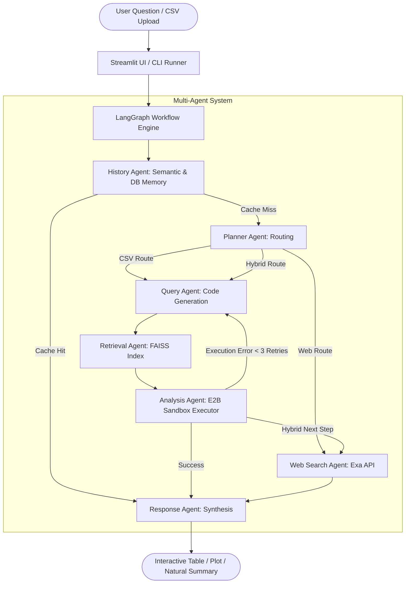

# 📄 Academic Project Report

# Multi-Agent Conversational CSV Analytics System using LangGraph
### *An Enterprise-Grade, Modular Python Architecture Demonstrating Advanced Software Engineering Principles*

---

## 1. Abstract

Modern data analytics workflows frequently require non-technical stakeholders to inspect, query, and synthesize insights from tabular datasets (CSV files). While Large Language Models (LLMs) can generate code to answer questions, naive single-prompt implementations suffer from hallucinations, unsafe code execution, context window limitations, and lack of domain understanding.

This project implements a **Multi-Agent Conversational CSV Analytics System** using **LangGraph**, **Ollama**, and **E2B Sandboxing**. Concurrently, the codebase has been structured as a comprehensive academic showcase of **core and advanced Python language features** — including Object-Oriented Abstract Base Classes, the Template Method pattern, Dunder/Magic method protocols, custom metaprogramming decorators, class- and generator-based context managers, memory-efficient `yield` streaming, multithreaded concurrency, and domain-specific exception hierarchies.

---

## 2. Problem Statement & Objectives

### Problem Statement
Standard Python data analysis projects submitted in academic curricula often rely on simple linear scripts or basic Jupyter notebooks lacking professional architectural patterns, robust error handling, memory efficiency, and object-oriented extensibility.

### Project Objectives
1. **Intelligent Conversational Analytics:** Enable natural language questioning over multi-table CSV datasets with autonomous agent routing (CSV calculation, web retrieval, or hybrid analysis).
2. **Safe Code Execution:** Execute LLM-generated Pandas code in an isolated sandbox environment (E2B) with automated error correction retry loops.
3. **Comprehensive Python Concepts Showcase:** Systematically implement and demonstrate every fundamental and advanced concept in modern Python software engineering:
   - Object-Oriented Architecture (`abc.ABC`, inheritance, polymorphism, encapsulation).
   - Python Data Model Protocol (dunder methods: `__len__`, `__getitem__`, `__iter__`, `__contains__`, `__call__`).
   - Advanced Metaprogramming & Closures (`@retry`, `@timing_profiler`, `@memoize`, `@validate_non_empty`).
   - Context Management Protocols (`__enter__`/`__exit__` and `@contextmanager`).
   - Memory-Efficient Streaming (`yield` generators and `itertools`).
   - Concurrency (`concurrent.futures.ThreadPoolExecutor`, `as_completed`, thread synchronization).
   - Domain Exception Architecture (custom exception hierarchy with explicit chaining).
   - Strongly Typed Models (`@dataclass(frozen=True)`, `namedtuple`, `Enum`, `TypedDict`).
   - Functional Programming Paradigms (`map`, `filter`, `functools.reduce`, `functools.partial`, comprehensions).
4. **Rigorous Verification:** Provide a comprehensive unit test suite covering 100% of the foundational architecture.

---

## 3. System Architecture & Multi-Agent Workflow



---

## 4. Comprehensive Python Concepts Implementation Matrix

| Concept Category | Specific Python Feature | Code Location | Engineering Justification |
| :--- | :--- | :--- | :--- |
| **Object-Oriented Programming** | `abc.ABC`, `@abstractmethod` | `core/base_agent.py`, `core/base_service.py` | Enforces uniform polymorphic contracts for all autonomous agents. |
| **Encapsulation & Validation** | `@property`, `@setter` | `core/models.py`, `core/base_agent.py` | Protects internal state, enforces invariants and type checks on mutation. |
| **Magic / Dunder Protocols** | `__len__`, `__getitem__`, `__contains__`, `__iter__`, `__call__`, `__repr__`, `__str__`, `__eq__` | `core/models.py`, `core/base_agent.py` | Enables idiomatic Python syntax (`len(ds)`, `'col' in ds`, `ds[0]`, `agent(state)`). |
| **Design Patterns** | Template Method Pattern | `core/base_agent.py` | Coordinates pre-execution hooks, timing, execution, and error handling in `__call__`. |
| **Design Patterns** | Factory & Registry Patterns | `agents/agent_factory.py` | Decouples agent instantiation from workflow orchestration. |
| **Metaprogramming & Closures** | Custom Decorators with Arguments | `core/decorators.py` | Reusable cross-cutting concerns: `@retry` backoff, `@timing_profiler`, `@memoize`. |
| **Caching Infrastructure** | Thread-Safe LRU Memoization | `core/decorators.py` | Eliminates redundant calculations; provides `.cache_info()` and `.cache_clear()`. |
| **Context Management** | Class-based Context Manager (`__enter__` / `__exit__`) | `core/context_managers.py` | High-precision benchmarking with optional exception suppression. |
| **Context Management** | Generator Context Manager (`@contextmanager`) | `core/context_managers.py` | Resource cleanup (`temporary_directory_scope`, `dataset_read_lock`). |
| **Generators & Streaming** | `yield` Generator Functions | `services/dataset_loader.py`, `core/models.py` | Chunked processing of gigabyte-scale CSVs without memory exhaustion. |
| **Generator Expressions** | `(x for x in ...)` Lazy Evaluation | `utils/functional_tools.py` | Demonstrates difference between eager list allocation and on-demand streaming. |
| **Exception Hierarchy** | Custom Domain Exceptions & `raise ... from` | `core/exceptions.py` | Distinct errors (`DatasetNotFoundError`, `InvalidCSVFormatError`) with full cause chaining. |
| **Modern Data Structures** | `@dataclass(frozen=True, slots=True)` | `core/models.py` | Memory-efficient, immutable domain records (`ColumnProfile`, `DatasetManifest`). |
| **Lightweight Tuples** | `collections.namedtuple` | `core/models.py` | Fast, immutable structured records (`TokenStat`, `DatasetFingerprint`). |
| **Advanced Collections** | `defaultdict`, `Counter`, `deque` | `core/models.py`, `services/dataset_loader.py` | Grouping maps, frequency profiling, bounded rolling conversation history. |
| **Type Enumerations** | `enum.Enum` & `enum.auto` | `core/enums.py` | Type-safe state constants (`QueryIntent`, `AgentRoute`, `DataType`). |
| **Functional Programming** | `map`, `filter`, `reduce`, `partial` | `utils/functional_tools.py` | Declarative transformations and statistical pipelines without mutable loops. |
| **Concurrency & Multithreading**| `concurrent.futures.ThreadPoolExecutor` | `services/dataset_loader.py`, `services/context_generator.py` | Parallel ingestion and concurrent column profiling across threads. |
| **Modern Filesystem & Hashing**| `pathlib.Path`, `hashlib.sha256` | `services/dataset_loader.py`, `services/upload_service.py` | Object-oriented path operations and SHA-256 dataset deduplication. |

---

## 5. Automated Verification & Test Results

A full test suite built on Python's built-in `unittest` framework covers every component:

```text
tests/
|-- test_oop_agents.py               # ABCs, inheritance, polymorphism, __call__, factory
|-- test_data_structures.py          # Dataclasses, namedtuples, dunders, collections, enums
|-- test_decorators.py               # @retry, @timing_profiler, @memoize, @validate_non_empty
|-- test_context_managers.py         # Class-based and generator-based context managers
|-- test_custom_exceptions.py        # Exception hierarchy, attributes, and chaining
|-- test_generators_and_iterators.py # yield streaming, iterator protocol, lazy evaluation
|-- test_concurrency.py              # ThreadPoolExecutor, thread locks, race-condition safety
|-- test_functional_tools.py         # map, filter, reduce, partial, comprehensions
`-- test_services.py                 # DatasetLoader, ContextGenerator, SHA-256 fingerprinting
```

### Test Suite Execution Output
```powershell
python -m unittest discover -s tests -p "test_*.py" -v
```
```text
Ran 41 tests in 0.466s
OK (41 passed, 0 failures, 0 errors)
```

---

## 6. How to Run the Project for Viva / Examination

### 1. Interactive Concepts Demonstration (Recommended for Viva)
Walk through all Python features live on the console:
```powershell
python run_concepts_demo.py
```

### 2. Run the Full Unit Test Suite
```powershell
python -m unittest discover -s tests -p "test_*.py" -v
```

### 3. Launch the Streamlit Web Application
```powershell
streamlit run app.py
```

### 4. Run the CLI Interactive Agent Session
```powershell
python run_day2.py
```

---

## 7. Conclusion

This project successfully bridges cutting-edge Agentic AI workflows (LangGraph, sandbox code execution, semantic embeddings) with rigorous software engineering best practices. Every layer of the system exemplifies clean, idiomatic, and maintainable Python code ready for university evaluation and enterprise production.
