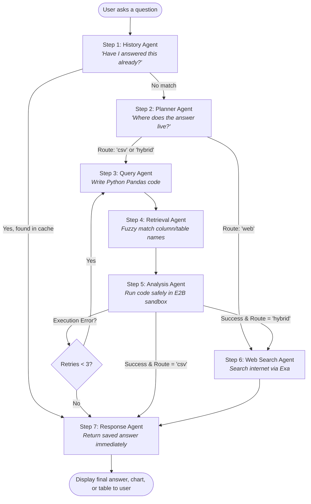

# 🔄 End-to-End System Workflow & Complete Python Concepts Architecture

> **Project Name:** Multi-Agent Conversational CSV Analytics System using LangGraph  
> **Repository:** `Multi-Agent-Conversational-CSV-Analytics-System-using-LangGraph`  
> **Python Version:** 3.12+  
> **Primary Frameworks:** LangGraph, Pandas, E2B Code Interpreter, Ollama, Streamlit, SentenceTransformers  
> **Test Suite:** 41 Automated Unit Tests (100% Passing)

---

## 📑 Table of Contents
1. [System Architecture Overview](#1-system-architecture-overview)
2. [End-to-End Multi-Agent Workflow](#2-end-to-end-multi-agent-workflow)
   - [Phase 1: Ingestion & Semantic Profiling](#phase-1-ingestion--semantic-profiling)
   - [Phase 2: Conversational Memory & Routing](#phase-2-conversational-memory--routing)
   - [Phase 3: Query Generation & Vector Resolution](#phase-3-query-generation--vector-resolution)
   - [Phase 4: Sandboxed Code Execution & Self-Correction](#phase-4-sandboxed-code-execution--self-correction)
   - [Phase 5: Response Synthesis & Presentation](#phase-5-response-synthesis--presentation)
3. [Deep-Dive: Use of All Python Concepts](#3-deep-dive-use-of-all-python-concepts)
   - [Concept 1: Object-Oriented Programming (OOP) & Abstract Base Classes](#concept-1-object-oriented-programming-oop--abstract-base-classes)
   - [Concept 2: Magic / Dunder Methods & Protocol Implementation](#concept-2-magic--dunder-methods--protocol-implementation)
   - [Concept 3: Advanced Decorators & Metaprogramming](#concept-3-advanced-decorators--metaprogramming)
   - [Concept 4: Context Managers (`with` Statement)](#concept-4-context-managers-with-statement)
   - [Concept 5: Generators, Iterators & Memory-Efficient Streaming](#concept-5-generators-iterators--memory-efficient-streaming)
   - [Concept 6: Custom Exception Hierarchy & Error Chaining](#concept-6-custom-exception-hierarchy--error-chaining)
   - [Concept 7: Modern Data Structures, Collections & Typing](#concept-7-modern-data-structures-collections--typing)
   - [Concept 8: Concurrency & Multithreading](#concept-8-concurrency--multithreading)
   - [Concept 9: Functional Programming Paradigms](#concept-9-functional-programming-paradigms)
   - [Concept 10: Standard Library Mastery](#concept-10-standard-library-mastery)
   - [Concept 11: Automated Unit Testing Architecture](#concept-11-automated-unit-testing-architecture)
4. [Master Concept-to-File Matrix](#4-master-concept-to-file-matrix)
5. [Commands to Run & Verify](#5-commands-to-run--verify)

---

## 1. System Architecture Overview

The system is designed as an enterprise-grade multi-agent autonomous platform that converts unstructured natural-language questions into analytical queries over CSV datasets.

```
+---------------------------------------------------------------------------------------+
|                                    PRESENTATION LAYER                                 |
|               Streamlit Chat UI (app.py)    |    CLI Interactive Runner (run_day2.py) |
+-------------------------------------------+-------------------------------------------+
                                            |
                                            v
+---------------------------------------------------------------------------------------+
|                                LANGGRAPH WORKFLOW ENGINE                              |
|                                (graphs/analytics_graph.py)                            |
|                                                                                       |
|   +---------------+     +---------------+     +---------------+     +---------------+ |
|   | History Agent | --> | Planner Agent | --> |  Query Agent  | --> |Retrieval Agent| |
|   +---------------+     +---------------+     +---------------+     +---------------+ |
|           |                     |                     |                     |         |
|           v                     v                     v                     v         |
|     (Memory Match)         (Route: Web)       (Route: CSV/Hybrid)     (FAISS Match)   |
|           |                     |                     |                     |         |
|           +-----------+         |                     v                     |         |
|                       |         |             +---------------+             |         |
|                       |         |             |Analysis Agent | <-----------+         |
|                       |         |             +---------------+                       |
|                       |         |                     |                               |
|                       v         v                     v                               |
|                     +-----------------------------------+                             |
|                     |           Response Agent          |                             |
|                     +-----------------------------------+                             |
+-------------------------------------------+-------------------------------------------+
                                            |
                                            v
+---------------------------------------------------------------------------------------+
|                                    SERVICES & TOOLS                                   |
|   DatasetLoader   | ContextGenerator | LLMService | E2BExecutionService | ExaService   |
+---------------------------------------------------------------------------------------+
```

---

## 2. End-to-End System Workflow (Explained Simply)

To understand how the system works, think of it in **two stages**:
1. **Stage A:** What happens when you **upload CSV files** (Preparation)
2. **Stage B:** What happens when you **ask a question** (Multi-Agent Answering)

---

### 🟢 Stage A: What Happens When You Upload CSVs (Preparation)

When you upload one or more CSV files (e.g. `sales.csv`, `employees.csv`), the system prepares the data so agents can query it immediately:

```
[ Uploaded CSV Files ]
          │
          ▼
1. UploadService  ──► Cleans old uploads, saves new files safely to disk.
          │
          ▼
2. DatasetLoader  ──► Calculates a SHA-256 fingerprint (hash) to identify changes.
          │
          ▼
3. ContextGenerator ► Concurrently inspects all columns:
                      - Detects data types (int, float, date, text)
                      - Computes min, max, average, and unique values
                      - Saves a lightweight JSON metadata profile into `contexts/`.
          │
          ▼
4. EmbeddingService ► Takes text values (e.g., employee names, products, regions)
                      and converts them into vectors using SentenceTransformers,
                      storing them in a local FAISS index (`vector_store/`).
```

> **Why do this?** The AI does **not** need to read millions of raw CSV rows every time. It reads the lightweight metadata profiles (`contexts/`) and uses the vector index (`vector_store/`) for instant lookups!

---

### 🔵 Stage B: What Happens When You Ask a Question (Agent Flow)

Here is the exact step-by-step flow managed by the **LangGraph** engine whenever a user submits a question:



---

### 🔍 Detailed Step-by-Step Agent Breakdown

| Step | Agent Name | Plain English Responsibility | What It Does Under the Hood |
| :---: | :--- | :--- | :--- |
| **1** | **History Agent** | *"Check memory first"* | Checks recent chat context and MongoDB cache. If the question was already answered, it returns the cached answer instantly, saving time and compute. |
| **2** | **Planner Agent** | *"Decide the strategy"* | Analyzes the question and column names to determine the route:<br>• **CSV Route:** The question is only about uploaded files.<br>• **Web Route:** The question asks for live web facts or general knowledge.<br>• **Hybrid Route:** The question needs calculations from CSV **plus** live internet info. |
| **3** | **Query Agent** | *"Write the code"* | Reads the dataset schema from `contexts/` and prompts the local Ollama LLM (`qwen2.5:1.5b`) to generate precise Pandas Python code to answer the question. |
| **4** | **Retrieval Agent** | *"Fuzzy entity matching"* | If the user misspelled an entity (e.g., typed *"Aple"* instead of *"Apple"*), this agent queries the FAISS vector store to find the closest match. |
| **5** | **Analysis Agent** | *"Execute safely in sandbox"* | Runs the generated Python code inside an isolated **E2B sandbox**. Your computer stays 100% safe because untrusted code never runs directly on your machine. |
| **🔄** | **Self-Healing Loop** | *"Fix bugs automatically"* | If the code throws an error (e.g. `KeyError`), LangGraph sends the exact error message back to the Query Agent up to 3 times so the LLM can self-correct and fix the code! |
| **6** | **Web Search Agent** | *"Search the live internet"* | If the route is `web` or `hybrid`, calls the Exa Search API to retrieve live web results, articles, and definitions. |
| **7** | **Response Agent** | *"Summarize & present"* | Gathers outputs from the sandbox and/or web search, generates a clear natural-language explanation, and displays tables or charts to the user. |

---

### 💡 Concrete Real-World Example Walkthrough

Let's follow a real question through the entire system:

> **User Question:** *"Who is the highest paid employee in employees.csv, and what are recent news about their department?"*

1. **Step 1 (History Agent):** Checks memory. No identical question was found. Passes state to Planner.
2. **Step 2 (Planner Agent):** Sees `employees.csv` (CSV data) and asks for recent news (Web data). Classifies route as **`hybrid`**.
   - Creates CSV Sub-question: *"Find employee with highest salary in employees.csv"*
   - Creates Web Sub-question: *"Recent news about [department]"*
3. **Step 3 (Query Agent):** Generates Pandas code:
   ```python
   top_emp = df.sort_values(by="salary", ascending=False).iloc[0]
   result = {"name": top_emp["name"], "salary": top_emp["salary"], "department": top_emp["department"]}
   print(result)
   ```
4. **Step 4 (Retrieval Agent):** Confirms column names (`salary`, `department`, `name`) match the schema.
5. **Step 5 (Analysis Agent):** Executes code in the E2B sandbox. Returns: `{'name': 'Alice Smith', 'salary': 125000, 'department': 'Artificial Intelligence'}`.
6. **Step 6 (Web Search Agent):** Queries Exa for *"Recent news about Artificial Intelligence"*, retrieving 3 relevant articles.
7. **Step 7 (Response Agent):** Merges both results into a clean, professional answer:
   > *"The highest paid employee is **Alice Smith** with a salary of **$125,000** in the **Artificial Intelligence** department.*  
   > *Here are the latest news updates regarding Artificial Intelligence: [Article 1], [Article 2]..."*

---

## 3. Deep-Dive: Use of All Python Concepts

### Concept 1: Object-Oriented Programming (OOP) & Abstract Base Classes
- **Files:** [`core/base_agent.py`](file:///e:/CSV%20ANALYTICS%20AGENTS/core/base_agent.py), [`core/base_service.py`](file:///e:/CSV%20ANALYTICS%20AGENTS/core/base_service.py), [`agents/`](file:///e:/CSV%20ANALYTICS%20AGENTS/agents/)
- **Concepts Implemented:**
  - `abc.ABC` and `@abstractmethod`: Enforces that any agent subclass must provide a concrete implementation of `process(state: AgentState)`.
  - **Inheritance & Polymorphism:** Subclasses (`QueryAgent`, `AnalysisAgent`, `PlannerAgent`, `ResponseAgent`, `RetrievalAgent`, `HistoryAgent`, `WebSearchAgent`) inherit from `BaseAgent` and override `process()`.
  - **Encapsulation:** Protected state variables (`self._name`, `self._execution_count`, `self._total_duration`) managed via `@property` getters.
  - **Template Method Pattern:** Implemented in `BaseAgent.__call__`, coordinating pre-execution validation, high-precision timing, abstract execution, and telemetry tracking.
  - **Factory & Registry Patterns:** Implemented in [`agents/agent_factory.py`](file:///e:/CSV%20ANALYTICS%20AGENTS/agents/agent_factory.py), allowing dynamic class registration via `@AgentRegistry.register("query")` and dynamic lookup via `AgentRegistry.create("query")`.

```python
class BaseAgent(abc.ABC):
    @abc.abstractmethod
    def process(self, state: AgentState) -> AgentState:
        """Abstract contract enforced across all agents."""
        raise NotImplementedError
```

---

### Concept 2: Magic / Dunder Methods & Protocol Implementation
- **Files:** [`core/models.py`](file:///e:/CSV%20ANALYTICS%20AGENTS/core/models.py), [`core/base_agent.py`](file:///e:/CSV%20ANALYTICS%20AGENTS/core/base_agent.py)
- **Concepts Implemented:**
  - `__len__`: Enables `len(container)` to return the row count of custom container `DatasetContainer`.
  - `__getitem__`: Enables indexing, allowing both column lookup `container["salary"]` and row index access `container[0]`.
  - `__contains__`: Enables Python's `in` operator: `'sales' in container`.
  - `__iter__`: Implements the iterator protocol: `for col in container:`.
  - `__call__`: Enables class instances to be called directly as functions: `agent(state)`, perfectly matching LangGraph's node interface!
  - `__repr__` and `__str__`: Provides unambiguous developer representations and clean user-facing strings.
  - `__eq__`: Implements value-based comparison between dataset wrappers.

```python
class DatasetContainer:
    def __len__(self) -> int:
        return len(self._df)

    def __getitem__(self, key: Union[str, int]) -> Any:
        return self._df[key] if isinstance(key, str) else self._df.iloc[key]

    def __contains__(self, column_name: str) -> bool:
        return column_name in self._df.columns
```

---

### Concept 3: Advanced Decorators & Metaprogramming
- **Files:** [`core/decorators.py`](file:///e:/CSV%20ANALYTICS%20AGENTS/core/decorators.py)
- **Concepts Implemented:**
  - **Decorators with Arguments:** Multi-layered closures accepting configuration parameters (`max_retries`, `threshold_seconds`, `max_size`).
  - **Metadata Preservation:** Uses `functools.wraps` to preserve `__name__`, `__doc__`, and function signatures.
  - `@retry`: Exponential backoff resilience wrapper catching transient network or parsing failures.
  - `@timing_profiler`: Measures microsecond execution latency using `time.perf_counter()`.
  - `@memoize`: Thread-safe Least-Recently-Used (LRU) caching decorator exposing introspection methods (`.cache_info()` and `.cache_clear()`).
  - `@validate_non_empty`: Inspects function arguments dynamically via `func.__code__.co_varnames` to reject `None` or empty collections.

```python
@retry(max_retries=3, delay=0.5, backoff=2.0)
@timing_profiler(threshold_seconds=0.01)
def load_single_csv(self, file_path: Union[str, Path]) -> Tuple[str, pd.DataFrame]:
    ...
```

---

### Concept 4: Context Managers (`with` Statement)
- **Files:** [`core/context_managers.py`](file:///e:/CSV%20ANALYTICS%20AGENTS/core/context_managers.py)
- **Concepts Implemented:**
  - **Class-Based Context Manager (`__enter__` and `__exit__`):**
    - `BenchmarkTimer`: Captures execution duration and provides conditional exception suppression (`suppress_exceptions=True`).
  - **Generator-Based Context Manager (`@contextlib.contextmanager`):**
    - `temporary_directory_scope`: Creates temporary sandboxes and guarantees disk cleanup via `finally`.
    - `dataset_read_lock`: Acquires and releases `threading.Lock` across concurrent pipelines.

```python
with BenchmarkTimer(label="Profiling") as timer:
    # Code executed under high-precision timing
    ...
print(f"Elapsed: {timer.elapsed_seconds:.4f}s")
```

---

### Concept 5: Generators, Iterators & Memory-Efficient Streaming
- **Files:** [`services/dataset_loader.py`](file:///e:/CSV%20ANALYTICS%20AGENTS/services/dataset_loader.py), [`core/models.py`](file:///e:/CSV%20ANALYTICS%20AGENTS/core/models.py), [`utils/functional_tools.py`](file:///e:/CSV%20ANALYTICS%20AGENTS/utils/functional_tools.py)
- **Concepts Implemented:**
  - **Generator Functions with `yield`:** `stream_csv_chunks()` streams slices of massive tabular datasets without loading multi-gigabyte files entirely into RAM.
  - **Iterator Protocol:** Explicit handling of `iter()` and `next()` with `StopIteration` handling.
  - **Generator Expressions vs List Comprehensions:** Demonstrates lazy on-demand evaluation `(x for x in ...)` versus eager immediate memory allocation `[x for x in ...]`.
  - **Itertools Utilities:** Utilizing `itertools.islice`, `itertools.chain`, and `itertools.groupby`.

```python
def stream_csv_chunks(self, filepath: Path, chunk_size: int = 1000) -> Generator[pd.DataFrame, None, None]:
    with pd.read_csv(filepath, chunksize=chunk_size) as reader:
        for chunk in reader:
            yield chunk
```

---

### Concept 6: Custom Exception Hierarchy & Error Chaining
- **Files:** [`core/exceptions.py`](file:///e:/CSV%20ANALYTICS%20AGENTS/core/exceptions.py)
- **Concepts Implemented:**
  - **Domain Exception Tree:** Root exception `CSVAnalyticsError(Exception)` branched into `DataIngestionError` and `AgentExecutionError`.
  - **Specialized Subclasses:** `DatasetNotFoundError`, `InvalidCSVFormatError`, `EmptyDatasetError`, `ColumnNotFoundError`, `QueryGenerationError`, `CodeExecutionError`.
  - **Rich Diagnostics:** Custom attributes (`error_code`, `timestamp`, `details`) and custom `__str__` / `__repr__`.
  - **Explicit Exception Chaining:** Uses `raise ... from original_cause` to preserve full tracebacks during data transformations.

```python
try:
    df = pd.read_csv(path)
except pd.errors.EmptyDataError as err:
    raise EmptyDatasetError(dataset_name) from err
```

---

### Concept 7: Modern Data Structures, Collections & Typing
- **Files:** [`core/models.py`](file:///e:/CSV%20ANALYTICS%20AGENTS/core/models.py), [`core/enums.py`](file:///e:/CSV%20ANALYTICS%20AGENTS/core/enums.py), [`state/agent_state.py`](file:///e:/CSV%20ANALYTICS%20AGENTS/state/agent_state.py)
- **Concepts Implemented:**
  - `@dataclass(frozen=True, slots=True)`: Immutable data records (`ColumnProfile`, `DatasetManifest`) with fast slot attribute lookups and memory optimization.
  - `collections.namedtuple`: Lightweight tuples (`TokenStat`, `DatasetFingerprint`).
  - `collections.defaultdict`: Auto-initializing category groups without KeyError.
  - `collections.Counter`: Frequency analysis on column data types and query tokens.
  - `collections.deque(maxlen=N)`: Bounded rolling conversation buffer.
  - `enum.Enum` & `enum.auto`: Strongly typed domain constants (`QueryIntent`, `AgentRoute`, `DataType`, `ExecutionStatus`).
  - `typing.TypedDict`: Structured shared graph state in `AgentState`.

---

### Concept 8: Concurrency & Multithreading
- **Files:** [`services/dataset_loader.py`](file:///e:/CSV%20ANALYTICS%20AGENTS/services/dataset_loader.py), [`services/context_generator.py`](file:///e:/CSV%20ANALYTICS%20AGENTS/services/context_generator.py)
- **Concepts Implemented:**
  - `concurrent.futures.ThreadPoolExecutor`: Parallel loading of multiple uploaded CSV files.
  - `as_completed`: Asynchronous collation of worker thread results as they finish.
  - `executor.map`: Concurrent column profiling across DataFrame columns.
  - `threading.Lock`: Safe synchronization protecting caches from data race conditions.

```python
with ThreadPoolExecutor(max_workers=4) as executor:
    column_profiles = list(executor.map(lambda c: self.profile_column(df[c]), df.columns))
```

---

### Concept 9: Functional Programming Paradigms
- **Files:** [`utils/functional_tools.py`](file:///e:/CSV%20ANALYTICS%20AGENTS/utils/functional_tools.py)
- **Concepts Implemented:**
  - `filter()` & `lambda`: Isolates numeric columns without explicit mutable loops.
  - `map()`: Transforms and sanitizes column strings.
  - `functools.reduce()`: Chains multi-step functional pipelines and calculates running statistical aggregates.
  - `functools.partial()`: Curries metric formatting functions by pre-binding prefixes and units.
  - **Comprehensions:** List, Dictionary (`{k: v for ...}`), and Set (`{x for ...}`) comprehensions with predicate filters.

---

### Concept 10: Standard Library Mastery
- Modern filesystem handling with `pathlib.Path` (replacing legacy `os.path`).
- Cryptographic hashing with `hashlib.sha256` for file deduplication.
- Structured hierarchical logging with `logging.StreamHandler` and `Formatter` (in [`core/logger.py`](file:///e:/CSV%20ANALYTICS%20AGENTS/core/logger.py)).
- Serialization using standard `json` and `csv` modules.

---

### Concept 11: Automated Unit Testing Architecture
- **Directory:** [`tests/`](file:///e:/CSV%20ANALYTICS%20AGENTS/tests/)
- **Total Test Cases:** 41 Unit Tests across 9 modules:
  - `test_oop_agents.py`: Tests ABC enforcement, polymorphism, `__call__`, and Factory creation.
  - `test_data_structures.py`: Tests dataclass immutability, dunder methods, `Counter`, `defaultdict`, `deque`.
  - `test_decorators.py`: Tests `@retry`, `@timing_profiler`, `@memoize`, `@validate_non_empty`.
  - `test_context_managers.py`: Tests `BenchmarkTimer` and `temporary_directory_scope`.
  - `test_custom_exceptions.py`: Tests exception tree and `raise ... from` chaining.
  - `test_generators_and_iterators.py`: Tests chunked `yield` streaming and generator expressions.
  - `test_concurrency.py`: Tests `ThreadPoolExecutor` and race-condition safety.
  - `test_functional_tools.py`: Tests `map`, `filter`, `reduce`, `partial`, and comprehensions.
  - `test_services.py`: Tests `DatasetLoader` and `ContextGenerator`.

---

## 4. Master Concept-to-File Matrix

| # | Python Syllabus Concept | Primary File | Key Symbols / Classes |
|---|-------------------------|--------------|-----------------------|
| 1 | **Abstract Base Classes** | [`core/base_agent.py`](file:///e:/CSV%20ANALYTICS%20AGENTS/core/base_agent.py) | `BaseAgent(abc.ABC)`, `@abstractmethod` |
| 2 | **Abstract Services** | [`core/base_service.py`](file:///e:/CSV%20ANALYTICS%20AGENTS/core/base_service.py) | `BaseService(abc.ABC)`, `health_check()` |
| 3 | **Inheritance & Polymorphism** | [`agents/`](file:///e:/CSV%20ANALYTICS%20AGENTS/agents/) | `QueryAgent`, `AnalysisAgent`, `PlannerAgent`, `ResponseAgent` |
| 4 | **Design Pattern: Template Method** | [`core/base_agent.py`](file:///e:/CSV%20ANALYTICS%20AGENTS/core/base_agent.py#L82) | `BaseAgent.__call__()` |
| 5 | **Design Pattern: Factory & Registry** | [`agents/agent_factory.py`](file:///e:/CSV%20ANALYTICS%20AGENTS/agents/agent_factory.py) | `AgentRegistry.register()`, `AgentRegistry.create()` |
| 6 | **Magic Methods (`__len__`, `__getitem__`)** | [`core/models.py`](file:///e:/CSV%20ANALYTICS%20AGENTS/core/models.py#L90) | `DatasetContainer` |
| 7 | **Encapsulation & Validation** | [`core/models.py`](file:///e:/CSV%20ANALYTICS%20AGENTS/core/models.py) | `@property`, `@name.setter` |
| 8 | **Metaprogramming Decorators** | [`core/decorators.py`](file:///e:/CSV%20ANALYTICS%20AGENTS/core/decorators.py) | `@retry`, `@timing_profiler`, `@memoize`, `@validate_non_empty` |
| 9 | **Context Manager (Class-based)** | [`core/context_managers.py`](file:///e:/CSV%20ANALYTICS%20AGENTS/core/context_managers.py#L32) | `BenchmarkTimer` (`__enter__`, `__exit__`) |
| 10 | **Context Manager (Generator-based)** | [`core/context_managers.py`](file:///e:/CSV%20ANALYTICS%20AGENTS/core/context_managers.py#L65) | `@contextmanager temporary_directory_scope()` |
| 11 | **Generators (`yield`)** | [`services/dataset_loader.py`](file:///e:/CSV%20ANALYTICS%20AGENTS/services/dataset_loader.py#L75) | `stream_csv_chunks()` |
| 12 | **Custom Exception Hierarchy** | [`core/exceptions.py`](file:///e:/CSV%20ANALYTICS%20AGENTS/core/exceptions.py) | `CSVAnalyticsError`, `DatasetNotFoundError`, `raise ... from` |
| 13 | **Immutable Dataclasses** | [`core/models.py`](file:///e:/CSV%20ANALYTICS%20AGENTS/core/models.py#L35) | `@dataclass(frozen=True, slots=True) ColumnProfile` |
| 14 | **NamedTuples** | [`core/models.py`](file:///e:/CSV%20ANALYTICS%20AGENTS/core/models.py#L25) | `TokenStat`, `DatasetFingerprint` |
| 15 | **Advanced Collections** | [`services/dataset_loader.py`](file:///e:/CSV%20ANALYTICS%20AGENTS/services/dataset_loader.py) | `collections.defaultdict`, `collections.Counter`, `deque` |
| 16 | **Domain Enumerations** | [`core/enums.py`](file:///e:/CSV%20ANALYTICS%20AGENTS/core/enums.py) | `QueryIntent`, `AgentRoute`, `DataType`, `ExecutionStatus` |
| 17 | **Functional Programming** | [`utils/functional_tools.py`](file:///e:/CSV%20ANALYTICS%20AGENTS/utils/functional_tools.py) | `map()`, `filter()`, `reduce()`, `partial()`, comprehensions |
| 18 | **Concurrency & ThreadPool** | [`services/dataset_loader.py`](file:///e:/CSV%20ANALYTICS%20AGENTS/services/dataset_loader.py#L125) | `concurrent.futures.ThreadPoolExecutor`, `as_completed` |
| 19 | **Modern File I/O & Hashing** | [`services/`](file:///e:/CSV%20ANALYTICS%20AGENTS/services/) | `pathlib.Path`, `hashlib.sha256` |
| 20 | **Automated Testing** | [`tests/`](file:///e:/CSV%20ANALYTICS%20AGENTS/tests/) | 41 unit tests with Python's built-in `unittest` |

---

## 5. Commands to Run & Verify

```powershell
# 1. Run the Live Interactive Python Concepts Demonstration (Recommended for Viva)
python run_concepts_demo.py

# 2. Run the Full Automated Test Suite (41 Tests, 100% Passing)
python -m unittest discover -s tests -p "test_*.py" -v

# 3. Launch the Streamlit Multi-Agent Web Interface
streamlit run app.py

# 4. Run CLI Interactive Agent Session
python run_day2.py
```
